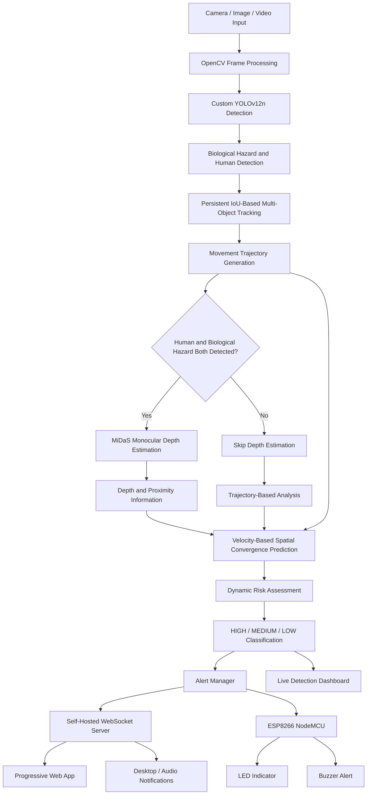

# 🚨 Real-Time Multi-Class Hazard Detection System

<p align="center">
  <b>AI-Powered Biological Hazard Detection | Predictive Risk Assessment | Intelligent IoT Alerts</b>
</p>

<p align="center">
  
  
  
  
  
  
  
</p>

---

## 📌 Overview

The **Real-Time Multi-Class Hazard Detection System** is an AI-powered computer vision and predictive risk assessment solution designed to identify biological hazards, monitor human–hazard interactions, and generate anticipatory warnings before potentially dangerous encounters occur.

The system combines a custom-trained YOLOv12n object detection model, persistent multi-object tracking, conditional MiDaS monocular depth estimation, and velocity-based spatial convergence analysis.

Unlike conventional object detection systems that simply identify objects and report their locations, this system analyzes object movement trajectories, estimates relative depth when required, and predicts potential human–hazard convergence to dynamically assess risk.

It also incorporates a self-hosted WebSocket notification framework, an offline-capable Progressive Web App (PWA), and ESP8266-based hardware alerts for real-time monitoring and warnings.

**The underlying research has been published as an Indian Patent Application: IN202641086880 A1.**

## ✨ Key Features

- **Multi-Class Biological Hazard Detection:** Identifies biological hazards such as venomous animals, dangerous insects, and toxic plants, along with humans.
- **Custom YOLOv12n Model:** Uses a custom-trained lightweight object detection model for real-time detection.
- **Persistent Multi-Object Tracking:** Uses IoU-based tracking to maintain object identities and generate movement trajectories across video frames.
- **Conditional Depth Estimation:** Activates MiDaS depth estimation when biological hazards and humans are simultaneously detected, reducing unnecessary computation.
- **Predictive Spatial Convergence:** Analyzes movement trajectories and velocity vectors to predict potential human–hazard encounters.
- **Dynamic Risk Assessment:** Evaluates predicted convergence, proximity, and depth information to classify potential hazards.
- **Multi-Level Risk Classification:** Generates HIGH, MEDIUM, and LOW risk alerts.
- **Real-Time Video Processing:** Supports camera, video, and image-based detection using OpenCV.
- **Self-Hosted Notification Framework:** Uses WebSocket communication for synchronized alerts without cloud infrastructure.
- **Offline-Capable PWA:** Provides notification access through a Progressive Web App.
- **IoT Hardware Integration:** Connects ESP8266 NodeMCU with an LED and buzzer for physical warnings.
- **Modular Architecture:** Separates detection, tracking, depth estimation, risk assessment, notifications, and visualization.

## 🏗️ System Architecture



## 🧠 Technologies Used

| Technology | Purpose |
|---|---|
| Python | Core application development |
| YOLOv12n | Custom multi-class object detection |
| PyTorch | Deep learning model execution |
| OpenCV | Image and video processing |
| MiDaS | Monocular depth estimation |
| NumPy | Numerical computation |
| IoU-Based Tracking | Persistent multi-object tracking |
| Velocity Vectors | Movement and convergence prediction |
| WebSocket | Real-time local notification communication |
| Progressive Web App | Offline-capable notification interface |
| ESP8266 NodeMCU | IoT hardware communication |
| LED and Buzzer | Physical warning mechanisms |

## 🔍 Working Methodology

### 1. Video Acquisition

The system receives visual input through a camera, video source, or stored images.

OpenCV processes the incoming frames and prepares them for object detection.

### 2. Multi-Class Object Detection

A custom-trained YOLOv12n model identifies biological hazards and humans in the input frames.

The detection pipeline provides object classes, bounding boxes, and confidence scores.

### 3. Persistent Multi-Object Tracking

An IoU-based tracking mechanism maintains object identities across consecutive frames.

The system records object movement trajectories to analyze changes in position over time.

### 4. Conditional Monocular Depth Estimation

MiDaS depth estimation is activated only when at least one biological hazard and one human are simultaneously detected within a frame.

When either category is absent, depth estimation is bypassed to reduce unnecessary computational overhead.

### 5. Predictive Spatial Convergence Analysis

The system analyzes the movement trajectories of humans and biological hazards.

Velocity vectors are calculated and used to project their positions forward in time.

This enables the system to estimate potential spatial convergence before the objects cross a predefined physical proximity threshold.

### 6. Dynamic Risk Assessment

The risk engine evaluates:

- Predicted human–hazard convergence likelihood.
- Relative proximity information.
- Estimated depth information.
- Object movement trajectories.

Based on these parameters, the system dynamically determines the appropriate risk level.

### 7. Risk Classification

Potential hazards are categorized into three levels:

| Risk Level | Description |
|---|---|
| HIGH | Significant predicted convergence or proximity risk |
| MEDIUM | Potential hazard interaction requiring attention |
| LOW | Lower immediate risk based on current assessment |

### 8. Intelligent Alert Generation

The alert manager generates structured notifications based on the calculated risk level.

### 9. Local Network Notification

A self-hosted WebSocket notification server synchronizes alerts with connected user devices.

The framework operates independently of cloud infrastructure and internet connectivity.

### 10. IoT-Based Physical Alerts

The ESP8266 NodeMCU activates the connected LED and buzzer according to the configured alert conditions.

### 11. Live Monitoring

The monitoring interface displays annotated detection information, risk levels, and alert information through the application's configured dashboard and PWA.

## 📊 Model Training and Performance

The project uses a custom-trained YOLOv12n model developed using a merged multi-class dataset.

### Model Specifications

| Parameter | Value |
|---|---|
| Model | YOLOv12n |
| Parameters | 2.56 Million |
| Computational Complexity | 6.3 GFLOPs |
| Dataset Classes | 14 |
| Training Dataset | 20,000+ images |
| Validation Images | 4,312 |
| Hyperparameter Optimization | Optuna |
| Optimization Strategy | Tree-structured Parzen Estimator (TPE) |
| Optimization Trials | 5 |

### Validation Performance

<badge color="success">Validation Results</badge>

| Metric | Score |
|---|---:|
| Precision | 0.702 |
| Recall | 0.635 |
| mAP@50 | **0.691** |

These metrics represent the reported validation performance of the custom-trained detection model.

## 💡 Research Contribution and Novelty

The primary research contribution is the integration of object detection, persistent tracking, conditional depth estimation, and predictive spatial convergence into a unified biological hazard assessment framework.

Key contributions include:

1. **Persistent Object Tracking:** Maintains object identities across multiple frames to generate movement trajectories.
2. **Conditional Depth Estimation:** Dynamically activates monocular depth estimation only when humans and biological hazards are detected together.
3. **Predictive Spatial Convergence:** Uses velocity-based trajectory analysis to anticipate potential encounters.
4. **Anticipatory Risk Assessment:** Determines risk levels based on predicted convergence, proximity, and depth information rather than relying only on current object positions.
5. **Cloud-Independent Communication:** Implements a self-hosted WebSocket notification framework that operates over a local network without cloud or internet dependency.
6. **Integrated Alert Delivery:** Supports synchronized notifications through connected devices and physical IoT warning mechanisms.

## 🏆 Patent & Intellectual Property

<badge color="success">Published Indian Patent Application</badge>

This research has resulted in a published Indian patent application.

**Official Patent Title:**

System and Method for Biological Hazard Detection and Risk Assessment

| Patent Information | Details |
|---|---|
| Publication Number | IN202641086880 A1 |
| Application Number | 202641086880 |
| Filing Date | 16 July 2026 |
| Publication Date | 24 July 2026 |
| Journal Number | 30/2026 |
| Applicant | Vellore Institute of Technology |
| Country | India |
| Patent Status | Published Indian Patent Application |

### Inventors

1. Valarmathi B
2. Anubhav Singh
3. Pragya Singh
4. Rashmita Kundu
5. Roushan Kumar Sinha

### Patented Technical Contributions

The published patent describes a biological hazard detection and risk assessment system incorporating:

- Detection of biological hazards, including venomous animals, dangerous insects, and toxic plants, along with humans.
- Persistent tracking of biological hazards and humans across multiple frames.
- Conditional activation of monocular depth estimation based on simultaneous human and biological hazard detection.
- Generation of movement trajectories and velocity-based prediction.
- Prediction of future spatial convergence between humans and biological hazards.
- Dynamic hazard risk assessment using predicted convergence likelihood, proximity, and depth information.
- Structured hazard notifications through a self-hosted local communication framework operating independently of cloud infrastructure and internet connectivity.
- Anticipatory hazard warnings before physical proximity is reached.

**The patent's central research contribution is predictive human–biological hazard convergence analysis combined with conditional depth estimation and cloud-independent anticipatory alert delivery.**

## 🔌 IoT Hardware Integration

The project incorporates an ESP8266 NodeMCU to provide physical warning mechanisms.

### Hardware Components

| Component | Connection |
|---|---|
| ESP8266 NodeMCU | Main IoT controller |
| LED | D1 |
| LED Resistor | 220Ω |
| Active Buzzer | Configured digital output |
| Ground | GND |

### Hardware Functionality

- LED activation provides a visual warning.
- The active buzzer generates an audible alert.
- The NodeMCU receives alert commands from the software.
- Hardware responses follow the configured risk and alert conditions.

**Note:** The buzzer GPIO and communication protocol should match the actual NodeMCU firmware configuration.

## ⚙️ Installation

### Prerequisites

- Python 3.10 or later
- Webcam or video input
- ESP8266 NodeMCU (optional)
- Internet connection for initial dependency and model-weight downloads
- Required model weights and configuration files

### Step 1: Clone the Repository

```bash
git clone https://github.com/Anubhav7070/Real-Time-Multi-Class-Hazard-Detection.git
```

### Step 2: Navigate to the Project

```bash
cd Real-Time-Multi-Class-Hazard-Detection
```

### Step 3: Create a Virtual Environment

```bash
python -m venv venv
```

**Windows:**

```bash
venv\Scripts\activate
```

**Linux / macOS:**

```bash
source venv/bin/activate
```

### Step 4: Install Dependencies

```bash
pip install -r requirements.txt
```

## ▶️ Running the Project

Run the main application using:

```bash
python main.py
```

Initialize the notification server using the configured server entry point if it runs separately.

Ensure that the required model weights, configuration files, and hardware communication settings are available before execution.

## 📁 Project Structure

```text
Real-Time-Multi-Class-Hazard-Detection/
│
├── main.py
├── detector.py
├── depth_estimator.py
├── risk_engine.py
├── alert_manager.py
├── notification_server.py
├── renderer.py
│
├── requirements.txt
├── README.md
│
└── [Model weights, configuration and hardware files]
```

*The listed Python modules represent the main application components. Refer to the repository for the complete current directory structure.*

## 🚀 Future Enhancements

- Improve detection robustness under different lighting and environmental conditions.
- Expand biological hazard detection classes.
- Improve trajectory prediction and convergence estimation.
- Optimize depth estimation for resource-constrained edge devices.
- Integrate additional surveillance cameras.
- Enhance multi-device notification synchronization.
- Improve false-positive reduction and risk calibration.
- Extend deployment to industrial, residential, agricultural, and public environments.

## 👨‍💻 Developer

**Anubhav Singh**

B.Tech – Information Technology  
Vellore Institute of Technology (VIT), Vellore

- GitHub: [@Anubhav7070](https://github.com/Anubhav7070)
- Project Repository: [Real-Time Multi-Class Hazard Detection](https://github.com/Anubhav7070/Real-Time-Multi-Class-Hazard-Detection)

## 📜 License

Add an appropriate open-source license before distributing this project for reuse.

---

<p align="center">
  <b>Predicting hazards before they become threats through AI, Computer Vision, Predictive Analytics and IoT.</b>
</p>
