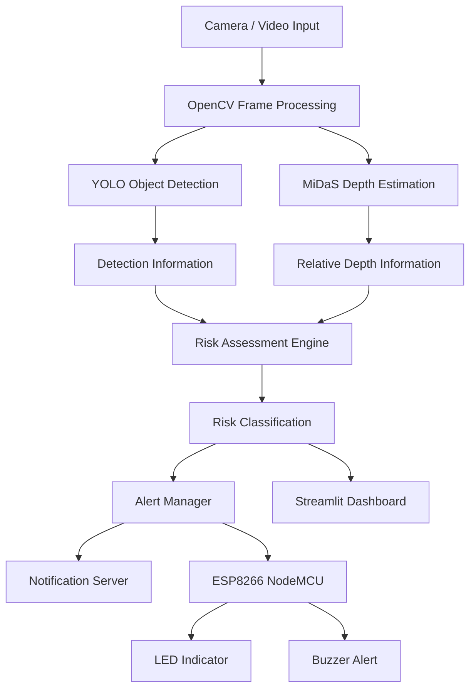

# 🚨 Real-Time Multi-Class Hazard Detection System

\<p align="center">   \<b>AI-Powered Hazard Detection | Depth-Aware Risk Assessment | IoT-Based Alert System\</b> \</p>

\<p align="center">   \   \   \   \   \ \</p>

## 📌 Overview

The **Real-Time Multi-Class Hazard Detection System** is an AI-powered computer vision solution designed to identify potential hazards in real time and assess their associated risk levels.

The system combines YOLO-based object detection, MiDaS depth estimation, computer vision, and an adaptive risk assessment engine to identify objects, estimate their relative distance, and determine potential danger.

Unlike conventional object detection systems that only identify objects, this project integrates **object recognition, depth-aware risk assessment, and hardware-based alert mechanisms** into a unified pipeline.

It also integrates an ESP8266 NodeMCU with an LED and buzzer to provide physical alerts when potentially dangerous situations are detected.

## ✨ Key Features

- **Real-Time Multi-Class Detection:** Detects multiple object categories using YOLO.
- **Depth Estimation:** Uses MiDaS to estimate relative depth from camera frames.
- **Distance-Aware Risk Assessment:** Evaluates detected objects based on their estimated proximity and detection information.
- **Adaptive Risk Classification:** Categorizes detected situations according to their risk level.
- **Live Video Processing:** Processes camera streams and video input using OpenCV.
- **Visual Monitoring:** Displays detection results and risk information through a Streamlit interface.
- **Automated Alerts:** Generates alerts when predefined risk conditions are met.
- **IoT Hardware Integration:** Connects ESP8266 NodeMCU with an LED and buzzer for physical warnings.
- **Modular Architecture:** Separates detection, depth estimation, risk analysis, alerts, and visualization.

## 🏗️ System Architecture



## 🧠 Technologies Used

| Technology       | Purpose                                               |
| ---------------- | ----------------------------------------------------- |
| Python           | Core programming language                             |
| YOLO             | Real-time object detection                            |
| MiDaS            | Monocular depth estimation                            |
| OpenCV           | Image and video processing                            |
| Streamlit        | Interactive monitoring interface                      |
| NumPy            | Numerical operations                                  |
| ESP8266 NodeMCU  | IoT hardware communication                            |
| LED              | Visual warning indicator                              |
| Buzzer           | Audible warning indicator                             |
| WebSocket / HTTP | Communication and alert integration, where configured |

## 🔍 Working Methodology

### 1. Video Acquisition

The system receives video input from a camera or prerecorded video source.

### 2. Object Detection

YOLO processes each frame and identifies objects belonging to the trained detection classes.

### 3. Depth Estimation

MiDaS estimates relative depth information for the detected objects using monocular image input.

### 4. Risk Assessment

The risk engine combines object detection information and depth estimates to evaluate potential hazards.

### 5. Risk Classification

The detected situations are categorized based on the implemented risk assessment logic.

### 6. Alert Generation

When a risk condition satisfies the configured alert criteria, the alert manager triggers the corresponding notification mechanism.

### 7. IoT-Based Physical Alert

The ESP8266 NodeMCU activates the connected LED and buzzer to provide physical warnings.

### 8. Live Visualization

The Streamlit interface presents detection results and relevant risk information.

## 📂 Project Structure

```text
Real-Time-Multi-Class-Hazard-Detection/
│
├── main.py
├── detector.py
├── depth_estimator.py
├── risk_engine.py
├── alert_manager.py
├── notification_server.py
├── renderer.py
│
├── requirements.txt
├── README.md
│
├── models/
│   └── trained_model_weights
│
├── hardware/
│   └── ESP8266 configuration
│
└── outputs/
    └── detection results
```

*Note: The structure above illustrates the main components. Adapt directory names to match the actual repository.*

## ⚙️ Installation

### Prerequisites

- Python 3.10 or later
- Webcam or video input
- ESP8266 NodeMCU (optional, for hardware alerts)
- Internet connection for downloading required model weights

### Step 1: Clone the Repository

```bash
git clone https://github.com/Anubhav7070/Real-Time-Multi-Class-Hazard-Detection.git
```

### Step 2: Navigate to the Project

```bash
cd Real-Time-Multi-Class-Hazard-Detection
```

### Step 3: Create a Virtual Environment

```bash
python -m venv venv
```

Activate it:

**Windows**

```bash
venv\Scripts\activate
```

**Linux / macOS**

```bash
source venv/bin/activate
```

### Step 4: Install Dependencies

```bash
pip install -r requirements.txt
```

## ▶️ Running the Project

Run the main application:

```bash
python main.py
```

Launch the Streamlit interface if the dashboard entry point is configured:

```bash
streamlit run main.py
```

Use the command corresponding to the actual application entry point in your repository.

## 🔌 IoT Hardware Integration

The project integrates an ESP8266 NodeMCU to provide physical alerts.

| Component     | NodeMCU Pin               |
| ------------- | ------------------------- |
| LED           | D1                        |
| LED resistor  | 220Ω                      |
| Active Buzzer | Configured digital output |
| Ground        | GND                       |

### Hardware Functionality

- LED activation provides a visual warning.
- The buzzer provides an audible warning.
- The NodeMCU receives alert commands from the software.
- Hardware alerts respond to the configured risk conditions.

**Note:** The buzzer pin and communication protocol must match the uploaded NodeMCU firmware and Python-side configuration.

## 📊 Risk Assessment

The system uses a depth-aware risk assessment approach to evaluate detected objects.

The assessment considers:

- Detected object category.
- Object detection confidence.
- Estimated relative depth.
- Configured risk thresholds.
- Alert conditions.

The risk assessment engine determines the appropriate response based on the implemented decision logic.

## 💡 Project Novelty

The primary contribution of this project is the integration of multiple technologies into a unified real-time hazard monitoring pipeline.

1. Combines object detection and monocular depth estimation.
2. Extends conventional object detection with depth-aware risk assessment.
3. Integrates software-based risk evaluation with physical IoT alerts.
4. Provides a modular architecture for real-time monitoring.
5. Supports visual and audible alert mechanisms for improved hazard awareness.

## 🚀 Future Enhancements

- Improve detection performance under different lighting and weather conditions.
- Integrate additional camera sources.
- Enhance distance estimation and calibration.
- Introduce advanced object tracking.
- Expand remote monitoring capabilities.
- Deploy the complete system on edge computing hardware.
- Improve alert prioritization and reduce false alarms.

## 👨‍💻 Developer

**Anubhav Singh**

B.Tech – Information Technology

VIT Vellore

- GitHub: [@Anubhav7070](https://github.com/Anubhav7070)
- Project Repository: [Real-Time Multi-Class Hazard Detection](https://github.com/Anubhav7070/Real-Time-Multi-Class-Hazard-Detection)

## 📜 License

Add the appropriate open-source license to this repository if you intend to distribute the project for reuse.

---

\<p align="center">
&#x20; \<b>Building intelligent systems for safer environments through AI, Computer Vision and IoT.\</b>
\</p>
